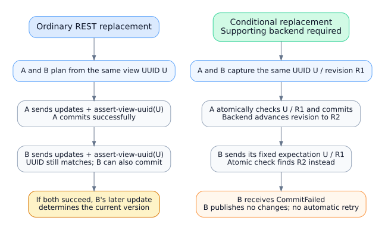

<!--
  Licensed to the Apache Software Foundation (ASF) under one
  or more contributor license agreements.  See the NOTICE file
  distributed with this work for additional information
  regarding copyright ownership.  The ASF licenses this file
  to you under the Apache License, Version 2.0 (the
  "License"); you may not use this file except in compliance
  with the License.  You may obtain a copy of the License at

    http://www.apache.org/licenses/LICENSE-2.0

  Unless required by applicable law or agreed to in writing,
  software distributed under the License is distributed on an
  "AS IS" BASIS, WITHOUT WARRANTIES OR CONDITIONS OF ANY
  KIND, either express or implied.  See the License for the
  specific language governing permissions and limitations
  under the License.
-->

# RFC: Iceberg SQL views in C++

Status: proposed for discussion.

## Motivation and scope

Add view format v1 metadata and REST catalog support so C++ engines can inspect
and manage persisted Iceberg SQL views. For example, an engine can save an
`analytics.active_customers` view, and another compatible engine can load its
schema and SQL. Engines supply and validate schemas and SQL, resolve referenced
tables, and execute queries. The library stores definitions and manages their
lifecycle.

Non-goals for the first release:

- SQL parsing or planning; engines validate and execute the SQL they read.
- Materialized views.
- View storage in non-REST backends. The in-memory catalog implements the same
  operations, but only as test infrastructure.
- Metadata file management: with REST the catalog server writes view metadata
  files, so the client submits updates and reads inline metadata only.

A **view version** records a definition: schema, SQL representations, resolution
context, and summary. Each SQL representation pairs a query with its engine
dialect, such as `spark`. A **metadata snapshot** is an owned, immutable copy of
the view's metadata, including retained versions, the current version, history,
and properties. It remains valid after later changes to the view.

## Proposed API

Reuse `Schema`, `Namespace`, `TableIdentifier`, and `Result`/`Status`. Keep view
metadata, versions, updates, and requirements separate from their table types.

| Surface | Operations |
| --- | --- |
| `ViewCatalog` | `CreateView`, `RegisterView`, `LoadView`, `ListViews`, `ViewExists`, `ReplaceView`, `RenameView`, `DropView` |
| `View` | `snapshot()`, `uuid()`, `location()`, current version and schema ids, `VersionById`, `SchemaById`, `History()`, properties, `SqlFor(dialect)`, `Refresh` |
| `View` mutations | `ReplaceVersion`, `UpdateProperties`, `UpdateLocation`; return a new `View` |

`ViewDefinition` contains the definition fields above. `ViewCreation` wraps it
with optional location and properties. Create/load/register return a `View`;
rename/drop return `Status`. `ViewCatalog::ReplaceView(identifier, requirements,
updates)` mirrors `UpdateTable` as the low-level commit API: requirements carry
the UUID assertion and updates are ordered view updates; it returns the server's
authoritative `View`. The `View` mutation helpers build these updates for
callers.

Details fixed before implementation:

- `SqlFor(dialect)` returns the matched representation — query text and dialect —
  not a bare string, so callers log or persist exactly what matched.
- `UpdateProperties(updates, removals)` takes the same arguments as
  `Catalog::UpdateNamespaceProperties`.
- `RegisterView(identifier, metadata_file_location)` mirrors `RegisterTable`
  and the REST `registerView` endpoint.
- Views and tables share one name space: create and register return
  `kAlreadyExists` when the identifier is taken by either.
- The library records the caller-supplied version summary, including
  `engine-name` and `engine-version`, unchanged; it never invents engine
  identity.

`ViewCatalog` is a separate pure interface; `Catalog` and `SessionCatalog` keep
their shape and ABI, and catalogs without view support simply do not implement
it. Catalogs with view support make one session-bound object implement both
interfaces, the way REST context catalogs are built today, so contextual
authentication and configuration apply to view sessions unchanged. Discovery is
a cast: `AsViewCatalog(catalog)` returns the same session-bound object as a
`ViewCatalog`, or `NotSupported`. There are no per-operation probes and no new
vtables on existing interfaces.

## Example: create, read, and replace

This illustrates the proposed API; view support is not implemented yet. Includes
are omitted, names are in namespace `iceberg`, and `catalog` is already configured.
The macros propagate `Result`/`Status` errors.

```cpp
Status ManageActiveCustomers(Catalog& catalog) {
  ICEBERG_ASSIGN_OR_RAISE(auto views, AsViewCatalog(catalog));
  const TableIdentifier id{Namespace{{"analytics"}}, "active_customers"};
  ViewCreation creation;
  creation.definition.schema = std::make_shared<Schema>(
      std::vector<SchemaField>{
          SchemaField::MakeOptional(1, "customer_id", int64())});
  creation.definition.representations = {
      {.sql = "SELECT customer_id FROM customers WHERE active = true",
       .dialect = "spark"}};
  creation.definition.default_catalog = "prod";
  creation.definition.default_namespace = Namespace{{"crm"}};

  ICEBERG_RETURN_UNEXPECTED(views->CreateView(id, creation));
  ICEBERG_ASSIGN_OR_RAISE(auto view, views->LoadView(id));
  ICEBERG_ASSIGN_OR_RAISE(auto sql, view->SqlFor("SPARK"));
  // The engine can now plan and execute sql.sql using the saved context.

  const auto before = view->snapshot();
  auto next = creation.definition;
  next.representations[0].sql =
      "SELECT customer_id FROM customers WHERE active = true AND country = 'US'";
  ICEBERG_ASSIGN_OR_RAISE(auto updated, view->ReplaceVersion(next));
  // updated contains the new definition; view and before retain the old one.

  ICEBERG_RETURN_UNEXPECTED(view->Refresh());
  // view now has the latest metadata; before remains usable and unchanged.
  return {};
}
```

The engine resolves the unqualified `customers` reference as `prod.crm.customers`,
using the stored defaults. The view itself lives in `analytics`. Both queries
return the same `customer_id` schema, so replacement can reuse it. `SqlFor("SPARK")`
returns the saved Spark representation — query text and dialect `spark` — while
`SqlFor("trino")` returns `NotFound`.

`Refresh()` checks that the UUID still identifies the original view and installs
metadata, session state, and the optional revision token together. A failed
refresh preserves the old state: a missing view returns `kNoSuchView`, and a
UUID mismatch — the view was dropped and recreated under the same name — also
returns `kNoSuchView`, with a message naming the expected UUID, so engines treat
"the view I hold is gone" uniformly and recover the same way: reload and
re-decide. Callers synchronize refresh with other operations on the same
handle. Mutation helpers return a new handle and leave the original unchanged.

## Metadata behavior

- Validate view-v1 IDs, references, required fields, and duplicate dialects without
  applying table-v1 schema restrictions. Parsing does not modify metadata.
  Invariants: `format-version` must be 1, `current-version-id` must reference a
  listed version, each version's `schema-id` must reference a listed schema, and
  `location` and each version's `default-namespace` must be non-empty.
- Match SQL dialects with ASCII case folding; return `NotFound` when the requested
  dialect is absent. Unlike Java's fallback lookup, never substitute another
  dialect. Store dialect strings as written and detect duplicates with the same
  folding. Preserve opaque unknown representations for round trips and property
  edits; reject definition changes involving them.
- Reuse schemas only when persisted content, including nested comments, matches.
  For example, changing only the `customer_id` comment preserves that change in
  the replacement while older versions keep their original comments.
  C++ `Schema::SameSchema` alone omits comments and cannot implement this rule.
- Reuse a retained version when its summary, ordered representations, default
  catalog, default namespace, and resolved schema id all match, ignoring
  `timestamp-ms` and `version-id` — the equivalence Java applies. Otherwise
  assign `max(version-id) + 1`, starting at 0 for a new view.
- Resolve REST `-1` placeholders in update order (`-1` means the last
  schema/version added in that request). Builders assign candidate IDs and emit
  `-1` for same-request references, and adopt the IDs returned by the server as
  authoritative.
- Stage one history entry per builder. Selecting `v1 -> v2 -> v3` locally appends
  only `v3` to history; intermediate `v2` is recorded only if committed separately.
  Returning from `v1 -> v2 -> v1` locally records a fresh activation of `v1`.
  Property/location-only changes add no history. `Build()` finalizes once;
  publication requires a commit. Take version and history timestamps from the
  time utility shared with table metadata (`CurrentTimePointMs`), and let tests
  inject the clock.
- Default `version.history.num-entries` to 10; require a positive value and
  protect current/new versions. Prevent dialect removal unless
  `replace.drop-dialect.allowed=true`.

## Commits and concurrency

Ordinary `ReplaceVersion` loads a fresh base without changing the original handle,
validates the definition, and submits standard REST updates. The server commits
atomically and returns authoritative metadata. UUID assertions detect
drop/recreation; two writers with the same UUID can both succeed. If both succeed,
the later commit determines the current version. Refresh does not close this race.
Rename/drop have no UUID guard. The first release ships this ordinary path only.



Make at most one mutation attempt per call. A lost commit response, HTTP 5xx, or
an unusable commit response returns `CommitStateUnknown`; the write may have
succeeded, so inspect state before deciding what to do next. This classification
must match the existing table commit path (`UpdateTable`) so tables and views
report identical outcomes for identical failures; the REST groundwork already
maps view commits (`409` to `CommitFailed`, `5xx` to `CommitStateUnknown`).
Other confirmed replacement conflicts also return `CommitFailed`. The library
never automatically replays a mutation or cleans up after an uncertain outcome.

### Extension: conditional replacement (deferred)

The diagram's second half describes a deferred extension. Callers requiring an
unchanged-since-read guarantee would use optional
`ReplaceVersionIfUnchanged(definition, expected_revision)`, backed by
`ViewCatalog::ReplaceViewIfUnchanged`. Capture metadata and its optional `ViewRevision`
together through `snapshot()`, then derive the change from that captured metadata.
The **revision** is an opaque backend token bound to the UUID, catalog, identifier,
and protocol. Every metadata publication advances it: changing a property keeps
the current SQL version but invalidates an earlier revision. The backend
atomically checks the fixed revision when publishing; conditional no-ops still
require a remote assertion.

Standard REST has no revision assertion, so this extension stays out of the
initial delivery: until a documented server profile provides atomic enforcement
and token/error semantics, it returns `NotSupported`, never falling back to an
ordinary write or changing the expectation. A stale conditional revision returns
`CommitFailed`; reload and reconsider the change before submitting another
request. A backend with only standard REST support also returns `NotSupported`,
leaving the caller to decide explicitly whether an ordinary write is acceptable.

Deferring costs little: the immutable snapshot already carries everything a
conditional check needs, so the extension can be added later without breaking
the API. The client-side addition is small — one requirement type, one catalog
method, one `View` helper. The blocker is the backend: standard REST has no
revision assertion, so shipping earlier would mean inventing a server contract
with no implementation to test against, risking divergence from whatever the
REST specification later adopts.

## REST integration

Honor advertised endpoints; unsupported operations return `NotSupported`. Follow
list pagination, the same mechanism as `ListTables`, and fall back from
unadvertised HEAD to advertised Load for existence checks. Load inline metadata
without requiring FileIO or storage access; `RegisterView` passes the stored
metadata location to the server, which reads it. Reuse contextual authentication
and `AuthManager::TableSession` for view sessions. Distinguish absent response
config from an empty map when refreshing overrides.

`RenameView` succeeds on HTTP 204 without an implicit load. A separate
`LoadView(to)` failure cannot change the completed rename result. For example,
renaming `analytics.active_customers` to `analytics.current_customers` succeeds
even if a subsequent load is denied by the destination's read permissions.
Old handles retain their identifier and snapshot; refreshing through the old
identifier returns `kNoSuchView`. Confirmed missing-view drops succeed.

## Delivery and validation

| PR | Scope | Required evidence |
| --- | --- | --- |
| 1 | Metadata, JSON, builder, ordered updates | Pinned Java/Rust fixtures; malformed metadata, comment-only changes, candidate IDs and version-reuse equivalence, history, retention, dialects, injected clock |
| 2 | View inspection and REST read operations | Snapshot lifetime, UUID refresh checks and failure kinds, endpoint support, pagination, contextual/view sessions |
| 3 | ViewCatalog mutations, register, in-memory catalog support | Reference-service lifecycle tests, conflicts, uncertain outcomes, rename/load separation, register-by-location, commit-failure parity with tables |

Run affected tests and pre-commit. Pin a view-capable REST service before PR 2;
initial candidates are the Java REST reference catalog, Apache Polaris, and
Lakekeeper. Ordinary REST support ships independently of the deferred
conditional extension, which is enabled only after testing atomicity with
competing requests against a real service.

## Feedback requested

1. Is the separate `ViewCatalog` interface — discovered by casting a
   session-bound `Catalog`, keeping `Catalog`'s ABI stable — the right split,
   or should view operations fold into `Catalog` with `NotSupported` defaults?
2. Are explicit dialect lookup, opaque representation preservation, single
   mutation attempts, and UUID mismatches reported as `kNoSuchView` the right
   initial policies?
3. Which REST service should provide interoperability tests — the Java reference
   catalog, Apache Polaris, or Lakekeeper — and is deferring the conditional
   replacement API acceptable?

## References

The format and REST specifications define the wire contract. Java guides lifecycle
behavior; Rust guides metadata and ordered updates. At the pinned Rust revision,
catalog view operations are absent.

- [View specification][spec] and [REST catalog specification][rest-spec].
- [Java view metadata builder][java-metadata] and [Rust view metadata builder][rust-builder].
- [Editable diagram source](diagrams/view-replacement-concurrency.dot).

[spec]: https://github.com/apache/iceberg/blob/524fe9ef1b4aa72be19623f667738b21a02b23b2/format/view-spec.md
[rest-spec]: https://github.com/apache/iceberg/blob/524fe9ef1b4aa72be19623f667738b21a02b23b2/open-api/rest-catalog-open-api.yaml
[java-metadata]: https://github.com/apache/iceberg/blob/524fe9ef1b4aa72be19623f667738b21a02b23b2/core/src/main/java/org/apache/iceberg/view/ViewMetadata.java
[rust-builder]: https://github.com/apache/iceberg-rust/blob/697abcee75b503fc106f445dae8bcfc401524dcc/crates/iceberg/src/spec/view_metadata_builder.rs
